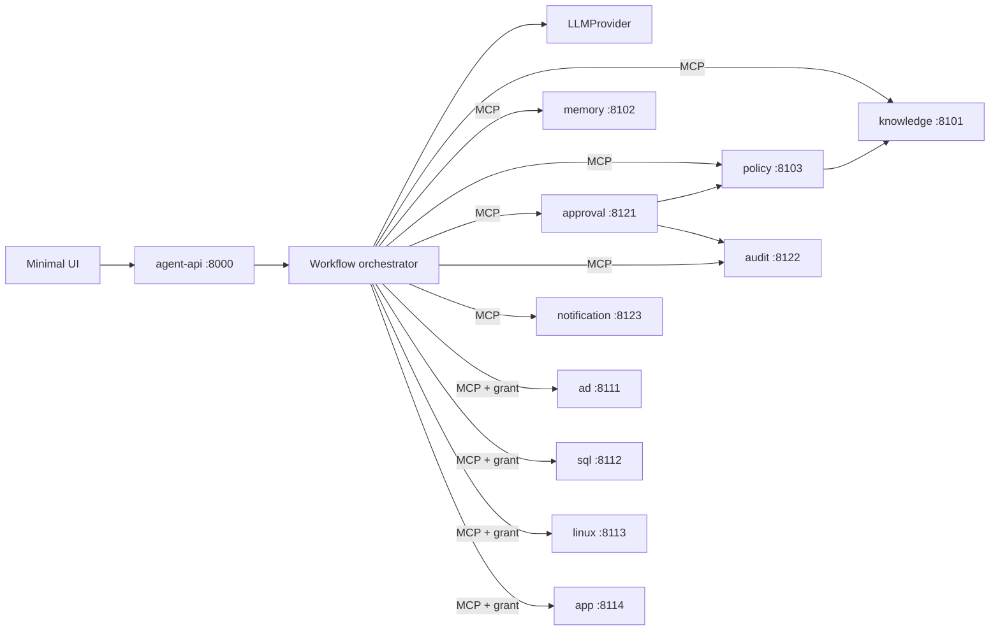

# Architecture

**Goal:** natural-language IAM request → safe, verified provisioning across AD, SQL Server, Linux and applications, using temporal knowledge of what exists, what is deprecated and what policy allows.
**Non-goals (POC):** real directories or credentials, HA, production auth, UI polish.

## Components

| Component | Responsibility | Contract |
|---|---|---|
| `agent-api` (8000) | HTTP API + minimal UI, authenticates the requester (mock SSO header), starts and resumes workflow runs | `docs/agent-workflow.md` |
| Orchestrator | Deterministic state machine; the only place LLM calls happen (2 states) | `docs/agent-workflow.md` |
| Capability registry | Discovers MCP servers, binds neutral capability tags to tools, filters tools for the LLM | `docs/mcp.md` |
| Knowledge, Policy, Memory, Approval, Audit, Notification | Platform MCP servers | `docs/contracts/knowledge-mcp.md`, `platform-mcps.md` |
| AD, SQL, Linux, App | Mock provisioners behind a `Provider` interface | `docs/contracts/provisioning-mcp.md` |

## Happy path
Request → intent → resolve objects in Knowledge → pin `knowledge_version`, check usability/dependencies/conflicts → memory hints → policy → plan (LLM, structured) → validate (+dry-run) → approval if required → grants → execute → verify against provider → record facts in Knowledge → audit → done.

## Stack
Python 3.12 · FastAPI (agent-api) · official `mcp` SDK (FastMCP, Streamable HTTP) · Pydantic v2 · SQLAlchemy 2 + Alembic · SQLite file per service · structlog + OpenTelemetry · pytest + hypothesis · Docker Compose. Frontend: static HTML/JS served by agent-api (no build step).

## Configuration (`.env.example`)
`LLM_PROVIDER` (`openai|azure_openai|anthropic|local|mock`) · `LLM_MODEL_*` per task · `LLM_API_KEY` (dev only) · `GRANT_SIGNING_KEY` · `STRICT_GRANTS=true` · `SEED_NOW` · `DATA_DIR` · `*_MCP_URL` per server · `APPROVAL_TTL_HOURS=72` · `MAX_PLAN_ACTIONS=25` · `LOG_LEVEL`.

## LLM abstraction
`LLMProvider.generate_structured(task, schema, messages) -> BaseModel`. Implementations: OpenAI, Azure OpenAI, Anthropic, local OpenAI-compatible, and `MockCassetteProvider` (replays recorded responses keyed by prompt hash; used in CI). Per-task routing (`intent`, `plan`) in config. Structured outputs only; one repair attempt; then fail closed.

## Decisions
| # | Decision | Why |
|---|---|---|
| D1 | The LLM is called only in UNDERSTAND_INTENT and GENERATE_PLAN | Everything else must be reproducible and testable |
| D2 | Knowledge is append-only with effective time + commit counter | Reproduce any past decision; schedule future changes |
| D3 | Plans use neutral capability tags; the registry binds them to tools | New systems without core code changes |
| D4 | Execution grants bind plan hash + per-call args hash | A hallucinated or altered call cannot execute |
| D5 | Knowledge = recorded desired state; provider = actual state | Reconciliation and drift detection stay meaningful |
| D6 | Mocks sit behind `Provider` interfaces | Swap in real backends without contract changes |
| D7 | Dry-run is a sub-step of VALIDATE_PLAN, not a separate state | Keeps one validation gate |
| D8 | Deprecated entitlement ⇒ refuse and suggest replacement; never substitute silently | The requester and approvers must see what is actually granted |

## Additions beyond the spec (★)
Shared `libs/iam_contracts` and `libs/mcp_common` · `mcp/app-server` and `mcp/notification-server` · import-linter boundary · identity tools in Knowledge · `llm_exposed` governance flag · grants bound to `plan_hash`/`args_hash` · capability tags + registry binding · `x-iam-ref` plan check · common provider contract (`health_check`, `get_account_state`) · `check_entitlement_usable` · derive/validate tools · Knowledge change pipeline · extra audit events · `simulate_policy_change`.
